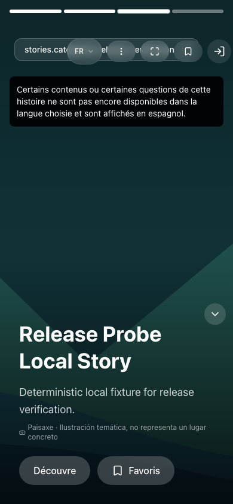
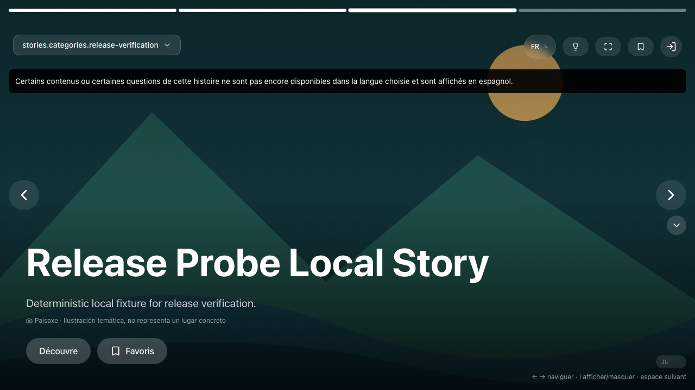

# Phase 12 illustration review

Owner decision pending. This review covers one original project illustration and its displayed disclosure. It does not approve any real photograph, source facts, paid calls, production promotion or Phase 12 as a whole.

The asset is [neutral-landscape.svg](../../public/images/neutral-landscape.svg), SHA-256 `a5b408f2d41522212bf8f3e2c49106ec4e8289fe9b24e5db208775645921b895`. It depicts abstract mountains, water and a sun without claiming a named location. The visible credit is `Paisaxe · Ilustración temática, no representa un lugar concreto`. Missing or rejected image provenance selects this asset; it also replaces the image alt text and clears old blur data. Real photographs still require individual permission, contextual accuracy and crop review.

These screenshots are from the actual local production build tested on 2026-10-11. They contain synthetic test content. The original screenshots are retained in private verification evidence; these copies are byte-identical and contain no test credentials or personal data.

| Surface | Review image |
| --- | --- |
| Immersive desktop, 1280×720 | [Open full screenshot](phase12-illustration-review/immersive-desktop.png) |
| Immersive mobile, 390×844 | [Open full screenshot](phase12-illustration-review/immersive-mobile.png) |
| Story landing before application hydration | [Open full screenshot](phase12-illustration-review/story-landing.png) |
| Typography-only social preview, 1200×630 | [Open full screenshot](phase12-illustration-review/social-preview.png) |

Automated checks verify native image loading, neutral alt/credit, rejected-photo request absence, viewport containment and the actual social PNG. Direct agent inspection confirms visible disclosure on these surfaces. The neutral fallback is also covered in favorites and desktop/mobile chat tests. No actual photograph is represented or approved by these checks.

The requested decision is whether this disclosed illustration is acceptable wherever an image lacks reviewed provenance. Production publication and old-media retirement remain separate.
